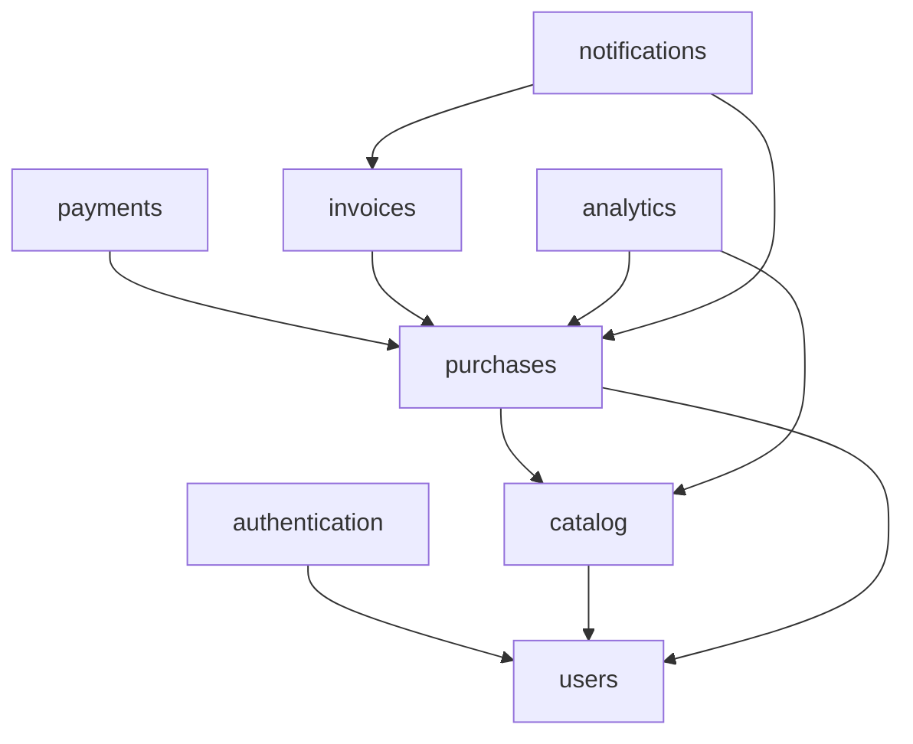

# Chapter I - Modular Monolith with Packwerk
`(avr. time for this chapter: 3 to 4 days)`

In the previous section, you used engines to extract features with clear boundaries. Engines are powerful, but they add overhead: each one is a gem with its own gemspec, dummy application, and configuration. For most domains inside a single application, a lighter approach is enough.

[Packwerk](https://github.com/Shopify/packwerk) is a tool created by Shopify to enforce boundaries inside a Rails monolith. The code is organized in **packs** (packages), each one declaring which other packs it depends on and which constants it exposes publicly. Packwerk statically analyses the code and reports every reference that breaks those rules.

In this chapter, you will reorganize the entire ebook store into packs. Every domain must live in its own pack, including an analytics system and a new invoicing system.

Continue building upon the application from the previous chapters. This chapter assumes you have completed the engines section.

## Introduction to Modular Monoliths

### Why Modularize?

- **Boundaries** - each domain has a clear owner and a clear public interface
- **Fewer side effects** - a change in one pack is less likely to break unrelated code
- **Onboarding** - new developers can understand one pack at a time
- **Evolution** - a well-isolated pack can later become an engine or a separate service

### Packs vs Engines

- **Engines** - isolated at runtime, reusable across applications, more setup
- **Packs** - isolated by static analysis, only for this application, almost no setup

> Reference: [Packwerk - Usage](https://github.com/Shopify/packwerk/blob/main/USAGE.md)

> Reference: [Shopify Engineering - Enforcing Modularity in Rails Apps with Packwerk](https://shopify.engineering/enforcing-modularity-rails-apps-packwerk)

### Steps to implement:

1. Read the Packwerk usage documentation
2. Read about dependency and privacy violations
3. Discuss with your tutor which parts of the ebook store should be packs and which should remain engines

## Setup

### Steps to implement:

1. Add the following gems to your project:
   - `packwerk` - the static analysis tool
   - `packwerk-extensions` - adds the privacy checker (removed from Packwerk core in version 3)
   - `packs-rails` - adds each pack's `app/` folders to the Rails autoload paths
   - `packs` (optional) - command line tool to create and move packs
2. Run `bundle exec packwerk init` and review the generated `packwerk.yml` and root `package.yml`
3. Enable the privacy checker in `packwerk.yml`:
   ```yaml
   require:
     - packwerk/privacy/checker
   ```
4. Run `bin/packwerk validate` and `bin/packwerk check` to confirm the setup works

> Reference: [packs-rails](https://github.com/rubyatscale/packs-rails)

## Pack Structure

Each pack lives in the `packs/` folder and mirrors the structure of a Rails application.

```
packs/
  purchases/
    package.yml
    app/
      models/
      controllers/
      jobs/
      services/
      public/        # the pack's public API
    spec/
```

A `package.yml` declares the pack's rules and dependencies:

```yaml
enforce_dependencies: true
enforce_privacy: true
dependencies:
  - packs/users
  - packs/catalog
```

### Steps to implement:

1. Understand the `enforce_dependencies` and `enforce_privacy` options
2. Understand the `app/public` folder: only constants inside it can be referenced from other packs
3. Keep each pack's specs inside the pack (`packs/<name>/spec`) and configure RSpec to find them

## Packs to Create

Every part of the ebook store must belong to a pack. The root application should only contain configuration, the layout, and shared infrastructure.

### Suggested Packs

- `packs/users` - users, sellers and buyers, profile, status (enable/disable)
- `packs/authentication` - sign up, sign in, sign out, password expiration (Chapter IV)
- `packs/catalog` - ebooks, status workflow, PDF previews, tags, and filters
- `packs/purchases` - purchase flow, transactions, seller commissions and balance
- `packs/notifications` - mailers and notification jobs
- `packs/analytics` - all statistics and reports
- `packs/invoices` - invoices and credit notes (new feature)
- `packs/payments` - integration with the webhooks engine from the engines section

> Note: You may define different packs based on your implementation. The important part is that every boundary is intentional. Discuss your design with your tutor before moving code.

### Expected Dependency Graph

Dependencies must flow in one direction. A pack can never depend, directly or indirectly, on a pack that depends on it.



### Steps to implement:

1. Draw your own dependency graph before moving any code
2. Create the packs (manually or with `bin/packs create packs/<name>`)
3. Move the existing code into the packs, one pack at a time (`bin/packs move` can help)
4. Run the test suite after moving each pack
5. Run `bin/packwerk check` and fix or record the violations (see "Handling Violations")

## Public APIs

Other packs must only use what a pack explicitly makes public. Models, private services, and jobs stay private.

### Steps to implement:

1. For each pack, define a small public API in `app/public`, for example:
   ```ruby
   # packs/catalog/app/public/catalog.rb
   module Catalog
     def self.find_ebook(id) = ...
     def self.live_ebooks_for(seller_id:) = ...
   end
   ```
2. Return simple data structures from public methods (e.g., `Data` objects or hashes), not Active Record models, so other packs cannot call private methods or change records directly
3. Replace direct references between packs (e.g., `Ebook.find` inside the purchases pack) with calls to the public API
4. Keep Active Record associations across packs to a minimum and discuss each one with your tutor

## Communication Between Packs with Events

Some packs need to react to what happens in other packs without creating a dependency. For example, after a purchase, analytics and invoices need to do their work, but `purchases` must not depend on them.

### Steps to implement:

1. Publish domain events from the `purchases` pack with `ActiveSupport::Notifications`:
   ```ruby
   ActiveSupport::Notifications.instrument("purchase.completed", purchase_id: purchase.id)
   ```
2. Subscribe to the events in the packs that need them (e.g., `analytics` and `invoices`), inside an initializer of each pack
3. Inside the subscribers, enqueue Sidekiq jobs instead of doing the work synchronously (see Chapter V of the base onboarding)
4. Define the event names and payloads in the publisher's public API, so subscribers depend on the publisher, and never the other way around
5. Publish events for at least: `purchase.completed`, `purchase.refunded`, `ebook.viewed`, `ebook.preview_downloaded`

> Reference: [Active Support Instrumentation](https://guides.rubyonrails.org/active_support_instrumentation.html)

## Analytics Pack

All statistics created in the previous chapters (purchases, previews viewed, page visits, visitor information, daily statistics) must move to the `analytics` pack. No other pack should calculate statistics.

### Steps to implement:

1. Move the statistics models, services, and jobs (e.g., `StatisticsReportJob`, `DailyStatisticsJob`) into the pack
2. Store analytics events in the pack's own tables (e.g., `analytics_events` with event name, subject, visitor information, and timestamp)
3. Record events by subscribing to the events published by `catalog` and `purchases`, never by being called directly from their controllers
4. Create aggregated tables for daily metrics instead of calculating everything on every request
5. Expose a public API for reports, for example:
   - `Analytics.ebook_stats(ebook_id)`
   - `Analytics.seller_dashboard(seller_id, period:)`
   - `Analytics.top_ebooks(period:, limit:)`
6. Create a dashboard page for sellers inside the pack, showing sales, views, previews, and conversion rate
7. Update the statistics emails from Chapter III to use the analytics public API

## Invoices Pack

Every purchase must generate an invoice. This is a new feature, built from the start as a pack.

### Requirements

- An invoice is created automatically for every completed purchase
- Invoices have a sequential number per year with no gaps (e.g., `2026/0001`, `2026/0002`)
- Invoices store buyer and seller data, ebook title, price, tax (VAT), and total at the moment of the purchase (later changes to the ebook or the users must not change existing invoices)
- Invoices cannot be edited or deleted after being issued
- A refund generates a **credit note** that references the original invoice
- Buyers can download their invoices as PDF
- Sellers can see a list of invoices for their sales

### Steps to implement:

1. Create the `Invoice` and `CreditNote` models inside the pack, with their own tables (`invoices_invoices`, `invoices_credit_notes`)
2. Subscribe to `purchase.completed` and enqueue an `Invoices::IssueInvoiceJob`
3. Generate the sequential number safely when two invoices are issued at the same time (e.g., a row lock on a counter table inside a transaction)
4. Make the job idempotent: the same purchase must never generate two invoices
5. Subscribe to `purchase.refunded` (triggered by the webhooks engine) and issue a credit note
6. Generate the PDF (e.g., [Prawn](https://github.com/prawnpdf/prawn) or [Grover](https://github.com/Studiosity/grover)) in a background job
7. Publish an `invoice.issued` event; the `notifications` pack subscribes and emails the PDF to the buyer
8. Expose a public API (e.g., `Invoices.for_buyer(buyer_id)`, `Invoices.for_seller(seller_id)`) and create the pages to list and download invoices

> Note: Discuss with your tutor what tax rules to apply. For this exercise, a fixed VAT rate is enough.

## Handling Violations

When you start using Packwerk in an existing application, there will be many violations. Packwerk allows recording them so you can fix them gradually.

### Steps to implement:

1. Run `bin/packwerk check` and read the violations reported
2. Understand the two types of violations:
   - **Dependency violation** - a pack references a constant from a pack it does not declare as a dependency
   - **Privacy violation** - a pack references a private constant of another pack
3. Run `bin/packwerk update-todo` to record existing violations in `package_todo.yml` files
4. Fix the recorded violations one by one, until every `package_todo.yml` is empty
5. Never add a dependency just to remove a violation; first ask whether the code is in the right pack

> Note: The goal of this chapter is to finish with **zero** recorded violations.

## Tooling

### Steps to implement:

1. Add `bin/packwerk check` and `bin/packwerk validate` to your CI pipeline, failing the build on new violations
2. Add [rubocop-packs](https://github.com/rubyatscale/rubocop-packs) to enforce conventions inside packs (e.g., public API files only in `app/public`)
3. Generate an image of your dependency graph with [visualize_packs](https://github.com/rubyatscale/visualize_packs) and add it to the README
4. (Optional) Define pack owners with [code_ownership](https://github.com/rubyatscale/code_ownership)
5. Run the specs of a single pack (e.g., `bundle exec rspec packs/invoices/spec`)

## Testing

### Steps to implement:

1. Move each spec to the pack that owns the tested code, including factories
2. Test each pack's public API as its contract with other packs
3. Test event subscribers: publish an event and verify the expected job is enqueued
4. In tests for one pack, stub other packs' public APIs instead of creating their records when possible
5. Write an end-to-end request spec for the complete flow: purchase → invoice issued → analytics recorded → email sent

## Exercise

Apply these concepts to your ebook store:

1. Install and configure Packwerk with dependency and privacy checks
2. Move all application code into packs; the root application should contain only configuration and shared infrastructure
3. Define a public API for every pack and remove all direct access to private code
4. Use events to decouple packs, without circular dependencies
5. Move all statistics into the `analytics` pack and create the seller dashboard
6. Build the `invoices` pack with sequential numbering, credit notes, and PDF download
7. Finish with zero violations in `package_todo.yml`
8. Run Packwerk in your CI pipeline
9. Document the packs, their responsibilities, and the dependency graph in the README

## Checklist

Before finishing this chapter, ensure you can:

- [ ] Explain the difference between packs and engines, and when to use each
- [ ] Configure Packwerk with dependency and privacy checks
- [ ] Design a dependency graph without cycles
- [ ] Define and use a pack's public API
- [ ] Decouple packs with events
- [ ] Record and fix dependency and privacy violations
- [ ] Generate sequential, immutable invoices safely under concurrency
- [ ] Enforce pack boundaries in CI
