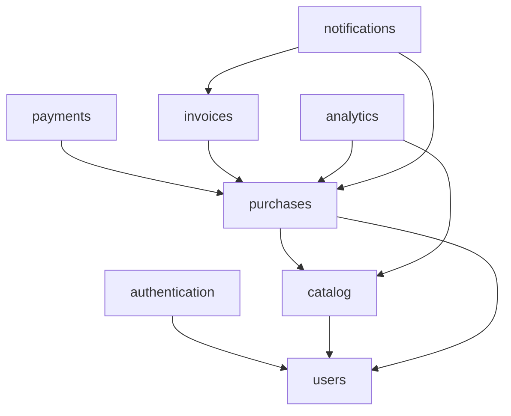

# Chapter I - Modular Monolith with Packwerk
`(avr. time for this chapter: 3 to 4 days)`

[Packwerk](https://github.com/Shopify/packwerk) enforces boundaries inside a Rails monolith. The code is organized in **packs**, each one declaring which other packs it depends on and which constants it exposes publicly.

In this chapter, you will reorganize the entire ebook store into packs. Every domain must live in its own pack, including an analytics system and a new invoicing system.

Continue building upon the application from the previous chapters.

> Reference: [Packwerk - Usage](https://github.com/Shopify/packwerk/blob/main/USAGE.md)

> Reference: [Shopify Engineering - Enforcing Modularity in Rails Apps with Packwerk](https://shopify.engineering/enforcing-modularity-rails-apps-packwerk)

## Exercise 1: Split the Application into Packs

### Requirements

- Dependency and privacy checks are enforced in every pack
- Every part of the ebook store belongs to a pack; the root application contains only configuration, the layout, and shared infrastructure
- Each pack has its own specs and factories
- Dependencies flow in one direction, with no cycles

### Suggested Packs

- `packs/users` - users, sellers and buyers, profile, status
- `packs/authentication` - sign up, sign in, sign out, password expiration
- `packs/catalog` - ebooks, status workflow, PDF previews, tags, and filters
- `packs/purchases` - purchase flow, transactions, commissions, and balance
- `packs/notifications` - mailers and notification jobs
- `packs/analytics` - all statistics and reports
- `packs/invoices` - invoices and credit notes
- `packs/payments` - integration with the webhooks engine



> Note: You may define different packs. The important part is that every boundary is intentional. Review your dependency graph with your tutor before moving code.

## Exercise 2: Public APIs

### Requirements

- Other packs only use what a pack exposes in `app/public`
- Public methods return simple data structures (e.g., `Data` objects), not Active Record models
- No pack queries another pack's models directly (e.g., `Ebook.find` inside `purchases`)
- Active Record associations across packs are minimal, and each one is justified

Example:

```ruby
# packs/catalog/app/public/catalog.rb
module Catalog
  def self.find_ebook(id) = ...
  def self.live_ebooks_for(seller_id:) = ...
end
```

## Exercise 3: Events Between Packs

After a purchase, analytics and invoices need to do their work, but `purchases` must not depend on them.

### Requirements

- Packs publish domain events with `ActiveSupport::Notifications`
- Subscribers enqueue Sidekiq jobs instead of doing the work synchronously
- Event names and payloads are defined in the publisher's public API
- Events to publish: `purchase.completed`, `purchase.refunded`, `ebook.viewed`, `ebook.preview_downloaded`, `invoice.issued`

## Exercise 4: Analytics Pack

All statistics from the previous chapters (purchases, previews viewed, page visits, visitor information, daily statistics) move to the `analytics` pack. No other pack calculates statistics.

### Requirements

- Statistics models, services, and jobs (e.g., `DailyStatisticsJob`) live in the pack
- Analytics events are stored in the pack's own tables (event name, subject, visitor information, timestamp)
- Events are recorded by subscribing to `catalog` and `purchases` events, never called directly from their controllers
- Daily metrics are aggregated in their own tables instead of being calculated on every request
- Public API, e.g.:
  - `Analytics.ebook_stats(ebook_id)`
  - `Analytics.seller_dashboard(seller_id, period:)`
  - `Analytics.top_ebooks(period:, limit:)`
- Seller dashboard with sales, views, previews, and conversion rate
- The statistics emails use the analytics public API

## Exercise 5: Invoices Pack

Every purchase generates an invoice. This is a new feature, built from the start as a pack.

### Requirements

- An invoice is issued automatically for every completed purchase, in a Sidekiq job
- The same purchase never generates two invoices
- Sequential number per year with no gaps (e.g., `2026/0001`), even when two invoices are issued at the same time
- Invoices store buyer and seller data, ebook title, price, VAT, and total at the moment of the purchase; later changes to the ebook or the users do not change existing invoices
- Invoices cannot be edited or deleted after being issued
- A refund (received through the webhooks engine) issues a **credit note** that references the original invoice
- PDF generated in a background job (e.g., [Prawn](https://github.com/prawnpdf/prawn) or [Grover](https://github.com/Studiosity/grover))
- The `notifications` pack emails the PDF to the buyer when `invoice.issued` is published
- Buyers can list and download their invoices; sellers can list the invoices of their sales

> Note: A fixed VAT rate is enough for this exercise.

## Exercise 6: Zero Violations

### Requirements

- Existing violations are recorded in `package_todo.yml` and fixed one by one
- The chapter ends with **zero** recorded violations
- Dependencies are never added just to remove a violation; first ask whether the code is in the right pack
- Packwerk runs in CI and fails the build on new violations
- [rubocop-packs](https://github.com/rubyatscale/rubocop-packs) enforces conventions inside packs
- The dependency graph is generated with [visualize_packs](https://github.com/rubyatscale/visualize_packs) and added to the README, with the responsibility of each pack
- End-to-end spec for the complete flow: purchase → invoice issued → analytics recorded → email sent

## Checklist

Before finishing this chapter, ensure you can:

- [ ] Explain the difference between packs and engines, and when to use each
- [ ] Design a dependency graph without cycles
- [ ] Define and use a pack's public API
- [ ] Decouple packs with events
- [ ] Record and fix dependency and privacy violations
- [ ] Generate sequential, immutable invoices safely under concurrency
- [ ] Enforce pack boundaries in CI
