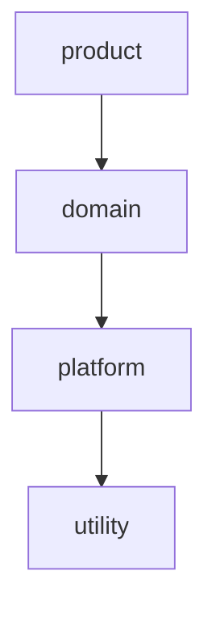

# Chapter II - Evolving a Modular Monolith
`(avr. time for this chapter: 2 to 3 days)`

Splitting the application into packs is only the first step. The real test of a modular design is whether it survives change: new features, new developers, and the natural tendency of code to cross boundaries.

In this chapter, you will add architectural layers to your packs, build a feature that crosses several packs, and fix a circular dependency introduced on purpose by your tutor.

Continue building upon the application from Chapter I. You should start this chapter with zero recorded violations.

## Architectural Layers

Dependencies alone do not prevent a bad design: if someone adds `analytics` as a dependency of `catalog`, Packwerk accepts it. Layers define which kinds of packs can depend on which others, so these mistakes are caught automatically.

### Suggested Layers

From top to bottom, a pack can only depend on packs in the same layer or in layers below:

- `product` - features close to the user, that combine several domains (e.g., `analytics`, `notifications`)
- `domain` - core business logic (e.g., `catalog`, `purchases`, `invoices`, `payments`)
- `platform` - building blocks with no business logic (e.g., `users`, `authentication`)
- `utility` - generic code that could be a gem (e.g., money formatting, PDF helpers)



### Steps to implement:

1. Enable the layer checker from `packwerk-extensions` in `packwerk.yml`:
   ```yaml
   require:
     - packwerk/privacy/checker
     - packwerk/layer/checker

   layers:
     - product
     - domain
     - platform
     - utility
   ```
2. Assign a layer to each pack in its `package.yml`:
   ```yaml
   enforce_layers: true
   layer: domain
   ```
3. Run `bin/packwerk check` and fix any layer violations
4. Discuss with your tutor the layer of each pack; the hardest ones are usually the most interesting design discussions
5. Document the layers in the README next to the dependency graph

> Reference: [packwerk-extensions](https://github.com/rubyatscale/packwerk-extensions)

> Note: You may define different layers based on your implementation, but keep them few and easy to explain.

## Exercise: A Feature Across Packs (Coupons)

Sellers want to create discount coupons for their ebooks. This feature touches several packs, which makes it a good test of your design.

### Requirements

- Sellers can create coupons with a code, a discount (percentage or fixed amount), an expiration date, and a maximum number of uses
- A coupon can apply to all ebooks of the seller or only to specific ebooks
- Buyers can apply a coupon code when purchasing an ebook
- The purchase price, the seller commission (10%), and the invoice must reflect the discount
- Coupon usage must appear in the analytics (uses per coupon, revenue with and without discount)
- A coupon cannot exceed its maximum number of uses, even when two buyers use it at the same time

### Steps to implement:

1. Before writing code, write a short design document and review it with your tutor:
   - Which pack owns coupons? A new `packs/coupons` pack, or part of `purchases`?
   - Which layer does it belong to?
   - Which packs depend on it, and which does it depend on?
   - Which public API methods and events are needed?
2. Implement the coupon management pages for sellers
3. Use the coupons public API from the `purchases` pack to validate and apply a coupon during the purchase transaction
4. Prevent exceeding the maximum uses under concurrency (e.g., a row lock or an atomic update with a condition)
5. Store the discount in the purchase and publish it in the `purchase.completed` event payload
6. Update the `invoices` pack to show the original price, the discount, and the final total, without depending on the `coupons` pack
7. Update the `analytics` pack to record coupon usage through events
8. Finish with zero violations, including layer violations

> Note: If you need to add dependencies that were not in your original graph, write down why. These decisions are the main outcome of this exercise.

## Exercise: Breaking a Circular Dependency

Circular dependencies are the most common way a modular monolith degrades. In this exercise, your tutor will introduce one in your code.

### Steps to implement:

1. Your tutor creates a branch with a change that introduces a cycle, for example:
   - `catalog` shows "best seller" badges by calling `Analytics.top_ebooks`, while `analytics` depends on `catalog`
   - `users` calls `Invoices.for_buyer` to show the number of invoices on the profile page
2. Run `bin/packwerk check` and identify the cycle using the dependency graph
3. Fix the cycle without simply recording the violations. Consider:
   - **Inverting the dependency** - the lower pack exposes an extension point, and the higher pack registers itself
   - **Using events** - the lower pack publishes, the higher pack subscribes
   - **Moving the code** - the feature belongs to a different pack (e.g., the profile page moves to a `product` layer pack)
   - **Storing derived data** - the higher pack writes a value (e.g., a `best_seller` flag) through the lower pack's public API
4. Explain to your tutor which solution you chose and why the others were worse in this case

## (Optional) Database Table Ownership

Packwerk only checks Ruby constants. Packs can still be coupled through the database, for example with SQL joins between tables of different packs.

### Steps to implement:

1. Make each table belong to exactly one pack and document the owner in the pack's README
2. Search for joins, `includes`, and raw SQL that cross pack boundaries, and replace them with public API calls
3. Write a script or a spec that fails when a migration in one pack changes a table owned by another pack
4. Discuss with your tutor when a cross-pack join is acceptable (e.g., for reports) and how to make it explicit

## (Optional) Packs vs Engines Decision Record

You now have experience with both packs and engines. Use it to make an informed decision.

### Steps to implement:

1. Convert the `payments` pack into an engine, or the `media_library` engine into a pack
2. Write an [Architecture Decision Record (ADR)](https://adr.github.io) comparing both approaches for that case:
   - Effort of the conversion
   - What changed in tests, configuration, and boot time
   - What became easier and what became harder
3. Decide which approach to keep and record the decision in `docs/adr/` in your repository

## (Optional) The "Shared" Pack Trap

When a constant is needed by many packs, it is tempting to create a `shared` (or `common`, `core`) pack and move it there. Over time, this pack grows and becomes a dependency of everything.

### Steps to implement:

1. Check whether your application has a pack, or a folder in the root application, that many packs depend on
2. For each constant inside it, decide whether it:
   - Belongs to a specific domain pack
   - Is generic enough to become a `utility` pack with a single responsibility (e.g., `packs/money`)
   - Could be extracted into a gem
3. Discuss with your tutor what rules prevent a new "shared" pack from appearing

## Checklist

Before finishing this section, ensure you can:

- [ ] Configure and explain architectural layers with Packwerk
- [ ] Design a feature that crosses several packs before implementing it
- [ ] Add a feature to a modular application without introducing violations
- [ ] Prevent race conditions in limited resources (e.g., coupon uses)
- [ ] Identify and break circular dependencies using different techniques
- [ ] Explain why a "shared" pack becomes a problem over time
