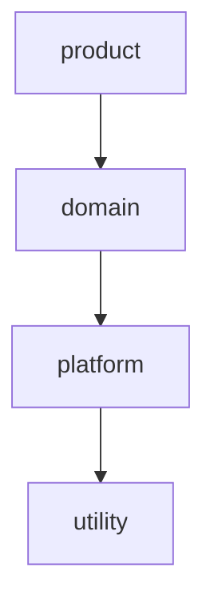

# Chapter II - Evolving a Modular Monolith
`(avr. time for this chapter: 3 to 4 days)`

The real test of a modular design is whether it survives change: new features, new developers, and the natural tendency of code to cross boundaries.

In this chapter, you will add architectural layers to your packs, build features that cross several packs, and fix a circular dependency introduced on purpose by your tutor.

Continue building upon the application from Chapter I. You should start this chapter with zero recorded violations.

## Exercise 1: Architectural Layers

Dependencies alone do not prevent a bad design: if someone adds `analytics` as a dependency of `catalog`, Packwerk accepts it. Layers define which kinds of packs can depend on which others.

### Suggested Layers

From top to bottom, a pack can only depend on packs in the same layer or below:

- `product` - features close to the user that combine several domains (e.g., `analytics`, `notifications`)
- `domain` - core business logic (e.g., `catalog`, `purchases`, `invoices`, `payments`)
- `platform` - building blocks with no business logic (e.g., `users`, `authentication`)
- `utility` - generic code that could be a gem (e.g., money formatting, PDF helpers)

### Requirements

- Layers are enforced with the layer checker from [packwerk-extensions](https://github.com/rubyatscale/packwerk-extensions)
- Every pack has a layer
- Zero layer violations
- Layers are documented in the README next to the dependency graph

> Note: Discuss the layer of each pack with your tutor; the hardest ones are usually the most interesting design discussions.

## Exercise 2: Coupons

Sellers want to create discount coupons for their ebooks. This feature touches several packs.

### Requirements

- Sellers create coupons with a code, a discount (percentage or fixed amount), an expiration date, and a maximum number of uses
- A coupon applies to all ebooks of the seller or only to specific ebooks
- Buyers apply a coupon code when purchasing an ebook
- The purchase price, the seller commission (10%), and the invoice reflect the discount
- The invoice shows the original price, the discount, and the final total, without `invoices` depending on the coupons code
- Analytics shows uses per coupon and revenue with and without discount, recorded through events
- A coupon never exceeds its maximum number of uses, even when two buyers use it at the same time

### Steps to implement:

1. Before writing code, write a short design document and review it with your tutor:
   - Which pack owns coupons? A new pack, or part of `purchases`?
   - Which layer does it belong to?
   - Which packs depend on it, and which does it depend on?
   - Which public API methods and events are needed?
2. Implement the feature
3. Finish with zero violations, including layer violations

> Note: If you need dependencies that were not in your original graph, write down why. These decisions are the main outcome of this exercise.

## Exercise 3: Seller Payouts

Sellers are paid once a month. This feature depends on purchases, refunds, invoices, and coupons, and is a good test of whether your public APIs are complete.

### Requirements

- On the first day of each month, a scheduled job calculates the payout of each seller for the previous month:
  - Commissions of completed purchases
  - Minus commissions of refunded purchases (including refunds of purchases from previous months)
  - Considering coupon discounts
- A payout has a status: `pending` → `approved` → `paid`; admins approve and mark payouts as paid
- A payout is never calculated twice for the same seller and month
- A paid payout cannot be changed; corrections go to the next month's payout
- Sellers see their payout history with the detail of each purchase and refund included
- Sellers receive an email when a payout is paid
- Each paid payout triggers an outgoing webhook (`payout.paid`) through the webhooks engine
- The payout totals match the sum of the invoices and credit notes of the period; write a spec that proves it

## Exercise 4: Breaking a Circular Dependency

Circular dependencies are the most common way a modular monolith degrades. In this exercise, your tutor introduces one in your code.

### Requirements

- Your tutor creates a branch with a change that introduces a cycle, for example:
  - `catalog` shows "best seller" badges by calling `Analytics.top_ebooks`, while `analytics` depends on `catalog`
  - `users` calls `Invoices.for_buyer` to show the number of invoices on the profile page
- The cycle is fixed without recording the violations
- The chosen solution is explained to your tutor, along with why the alternatives were worse in this case:
  - **Inverting the dependency** - the lower pack exposes an extension point, and the higher pack registers itself
  - **Using events** - the lower pack publishes, the higher pack subscribes
  - **Moving the code** - the feature belongs to a different pack
  - **Storing derived data** - the higher pack writes a value (e.g., a `best_seller` flag) through the lower pack's public API

## Exercise 5 (Optional): Database Table Ownership

Packwerk only checks Ruby constants. Packs can still be coupled through the database.

### Requirements

- Every table belongs to exactly one pack, documented in the pack's README
- No joins, `includes`, or raw SQL across pack boundaries, except for documented reporting cases
- A spec fails when a migration in one pack changes a table owned by another pack

## Exercise 6 (Optional): Packs vs Engines Decision Record

### Requirements

- Convert the `payments` pack into an engine, or the `media_library` engine into a pack
- Write an [Architecture Decision Record (ADR)](https://adr.github.io) comparing both approaches: conversion effort, changes in tests and configuration, what became easier and what became harder
- Record the final decision in `docs/adr/`

## Exercise 7 (Optional): The "Shared" Pack Trap

When a constant is needed by many packs, it is tempting to create a `shared` pack. Over time, it becomes a dependency of everything.

### Requirements

- Find any pack or root folder that most packs depend on
- Move each constant inside it to a domain pack, a small `utility` pack with a single responsibility (e.g., `packs/money`), or a gem
- Agree with your tutor on rules that prevent a new "shared" pack from appearing

## Checklist

Before finishing this section, ensure you can:

- [ ] Enforce architectural layers with Packwerk
- [ ] Design a feature that crosses several packs before implementing it
- [ ] Add features to a modular application without introducing violations
- [ ] Prevent race conditions in limited resources (e.g., coupon uses)
- [ ] Identify and break circular dependencies using different techniques
- [ ] Explain why a "shared" pack becomes a problem over time
